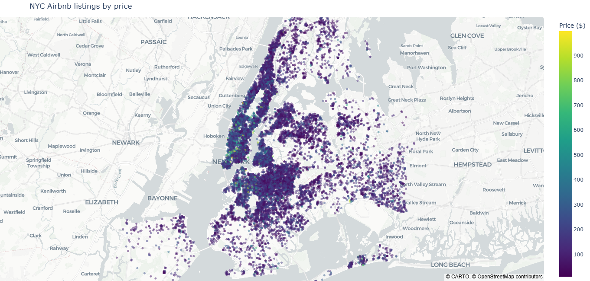

# NYC Airbnb Market Analysis

An exploratory analysis of 20,000+ New York City Airbnb listings, examining what drives price differences and how supply is distributed across the city.

---

## The Question

What explains price differences across NYC Airbnb listings, and how is supply distributed across the city?

## The Data

Inside Airbnb listings snapshot for New York City, 2024. 20,770 raw listings across 22 fields, cleaned to 20,539 for analysis.

## Key Findings

**1. Location is the strongest price differentiator, and it operates at the neighbourhood level, not the borough level.**
Manhattan has the highest median price (\$150) and the Bronx the lowest (\$89), but the spread within boroughs is larger than between them. Tribeca (\$317 median) and Woodside (\$49 median) sit in the same market and differ by 6.5x.

**2. Room type roughly doubles the price, and the effect compounds with location.**
Entire homes have a median of \$160 versus \$80 for private rooms. Manhattan entire homes (\$170) and Bronx private rooms (\$65) differ by 2.6x from just two variables.

**3. Price is explained by what a listing is, not how it behaves.**
Listing size correlates with price (beds 0.43, bedrooms 0.41, baths 0.32). Reviews, availability, and host portfolio size do not. Review activity peaks in the middle of the price distribution rather than rising with it.

**4. Supply is split between small hosts and a professional tier.**
The average host runs 1.67 listings, but the top 1 percent control 15.5 percent of supply. The largest single host operates 143 listings. The market is neither dominated by a handful of giants nor fully fragmented.

## Geographic Distribution



Each point represents a listing, colored by price. Higher-priced listings cluster in Manhattan and brownstone Brooklyn.

## Stack

Python, pandas, Plotly, seaborn. Analysis in a single Jupyter notebook.

## Repository Structure

```
.
├── README.md
├── nyc_airbnb_map.png
├── nyc-airbnb-market-analysis.ipynb
├── data/
│   └── new_york_listings_AirBnB_2024.csv
└── Week 1/
    └── Day 1/
        ├── day1_note.ipynb
        ├── output.png
        └── availability_365_distribution.png
```

The `Week 1/` folder contains an earlier EDA notebook and supporting images from 2024, kept for reference. The analysis at the root is a from-scratch rewrite with a proper business framing.
